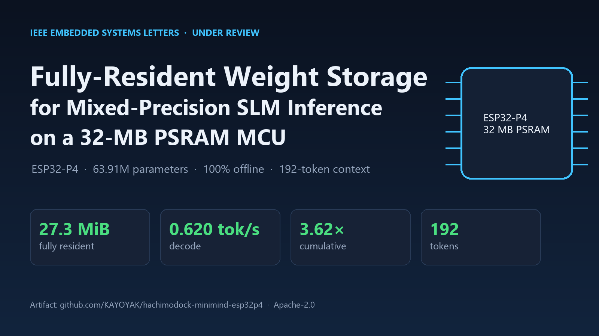
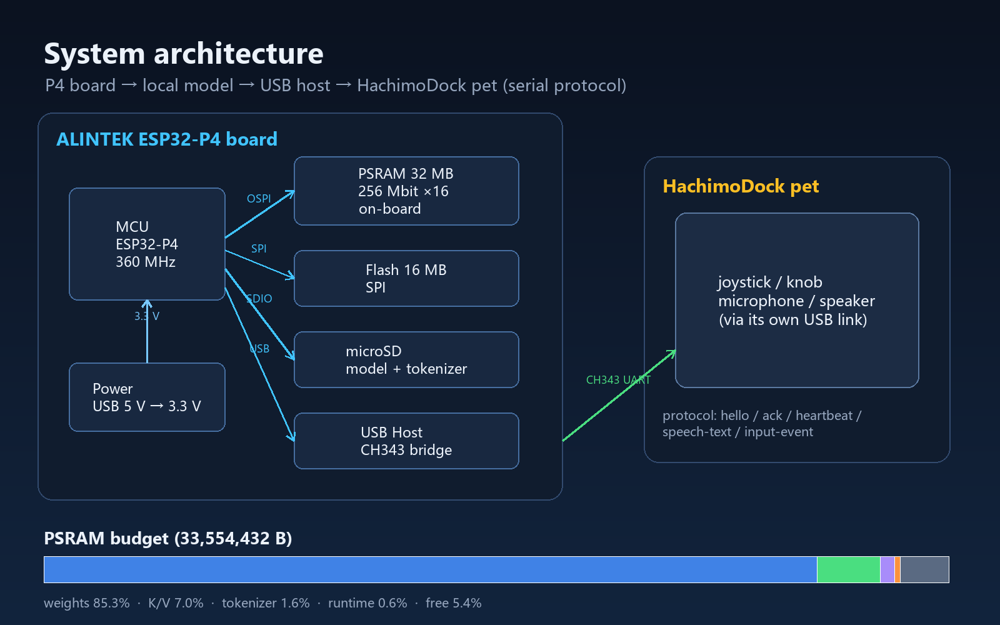
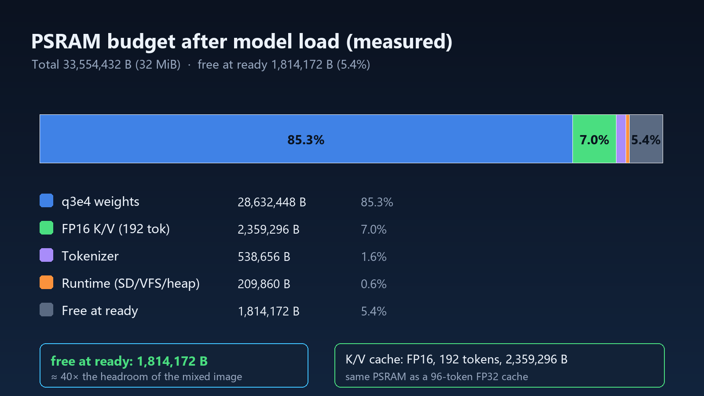
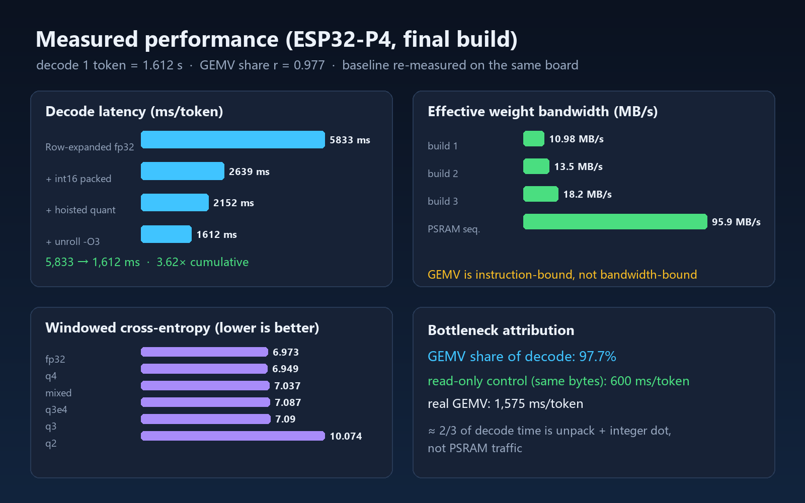
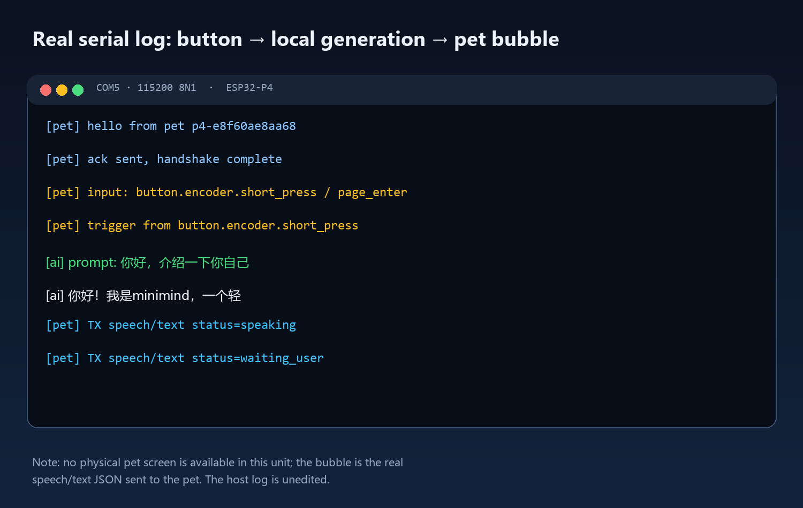
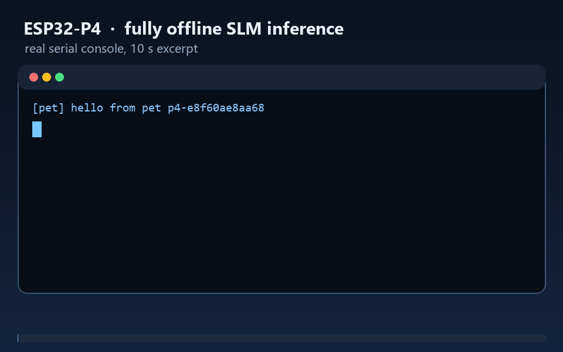

# Showcase

> 真实测量数据 + 真实串口日志生成的展示素材。当前没有屏幕 / 3D 外壳，实物照片与
> 宠物气泡视频待硬件到货后补充。

## Hero

## System architecture

## PSRAM budget (measured)

## Measured performance

## Real serial demo

> GIF 内容为真实串口记录：`hello → ack → 摇杆中键 → 本地生成 → speech/text`。
> 由于没有物理屏幕，气泡以 JSON 形式显示；宠物气泡视频待屏幕到货后补。

## Hardware photos / video

- ⏳ 板子 + 宠物 + 屏幕 + 3D 外壳实拍；
- ⏳ “上电 → 按键 → 气泡回复”短视频；
- 等硬件到货后更新本页。